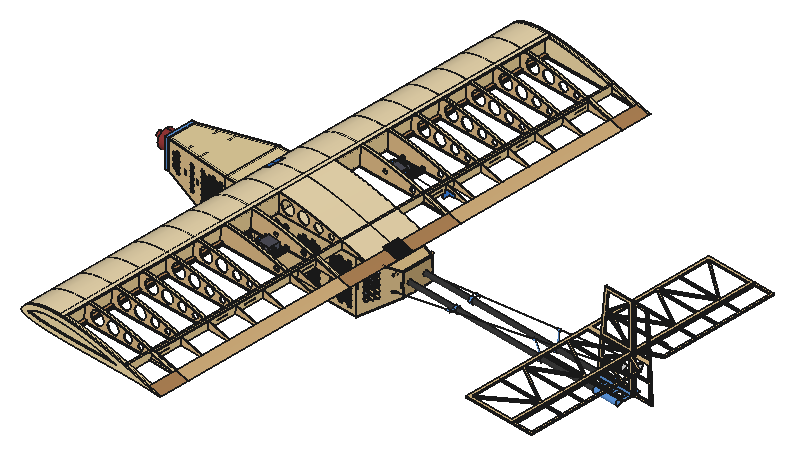

# Water-drop RC aircraft — Boeing NAC 2026-27, IIT Madras zone

A hand-launched electric aircraft that carries **1000 mL of water** in a sealed, removable reservoir and drops it on one pilot command over the release zone. Score = water mass × 100 / empty mass, so every part is designed light, and strong enough to survive every flight (one aircraft, repairs only).

**▶ Webpage with the wing build video, the Indian BOM and the wing files:** https://jagathsrujan.github.io/water-drop-rc-wing/

## The aircraft

| Part | Design | Status |
|---|---|---|
| **Wing rev A** | 990 mm span, 280 mm chord, SD7062, laser-cut balsa ribs, carbon-capped spar, sheeted D-box, MG90S ailerons; high wing on rubber bands, +3° incidence | Done: CAD, laser DXF, STL, cut list, BOM, build video |
| **Reservoir rev A.2** | 1 L Bisleri bottle lying along the pod, neck aft; pin-latched trapdoor at the bottle bottom (rear hinge, MG90S pulls the pin), one-way vent in the fill cap, safety pin with a flag; filled in place through the nose hatch | Accepted for test prints |
| **Fuselage pod rev B (balsa)** | Laser-cut balsa box with every kink on a former; cross-laminated sides with hex lightening under film; lite-ply U-formers open at the top so the bottle lifts out; keels, longerons, lite-ply front-stop ring for the 10 g nose-in load; PETG nose ring; tabs and slots on every former | Adopted (D-068); fit checks and hand strength estimate pass |
| **Boom and tail** | 2 × Ø10/8 carbon tubes; cruciform built-up balsa tail (stabiliser above the wing wake), elevator and rudder, tail servos in the pod | Modelled (rev A tail, carried into rev B) |
| **Electronics** | DYS D2830 1000 KV, Hobbywing Skywalker 40A V2 (5 A switching BEC), 3S 1000 mAh, fixed 10 × 5 prop, MG90S servos | Selected (D-066), shopping list from Robu.in |
| **Assembly jigs** | Removable PLA jigs: floor wedges, side squares, nose taper blocks, tube cradles (sets the tail incidence), wing-seat gauges | STL ready (D-069) |

## Key numbers (estimates until the parts are weighed)

| Item | Value |
|---|---|
| Wing | 156.6 g, 184.0 g with 2 × MG90S |
| Balsa pod (skin, formers, hard points, saddles, skids) | 133.1 g |
| Tail (tubes, tail block, surfaces, pushrods) | 78.1 g |
| Motor, prop, ESC, battery | 192 g |
| **Empty aircraft** | **≈ 689 g** |
| **Loaded (1000 mL)** | **≈ 1685 g** |
| **Score** (996 g water) | **≈ 144.5** |
| Loaded stall speed, Bengaluru / Chennai | ≈ 9.2 / 8.8 m/s (requirement R6 ≤ 9.0 in Bengaluru: still open) |
| Static thrust limit (T/W ≤ 1.37 measured in Bengaluru) | ≈ 940 g |
| Pod strength (hand estimate, ultimate = 1.5 × limit loads) | all design-load margins ≥ 1.31 |

## Open in Onshape or SolidWorks

[`design/cad_fuselage_balsa/export/WaterDrop_revB_assembly.step`](design/cad_fuselage_balsa/export/WaterDrop_revB_assembly.step) — the full aircraft as one STEP assembly (AP214, mm), with subassemblies `Fuselage_BalsaPod`, `Reservoir`, `Wing_revA`, `Tail`, `Electronics`; every part named and coloured.
- **Onshape:** Import, keep "Create assembly" ticked.
- **SolidWorks:** File → Open → STEP.

The jigs are in [`design/cad_fuselage_balsa/export/Jigs_revB.step`](design/cad_fuselage_balsa/export/Jigs_revB.step) and as STL in [`design/cad_fuselage_balsa/jigs/`](design/cad_fuselage_balsa/jigs/). Frame: origin at the wing leading edge on the centreline, X aft, Y right, Z up.

## What is here

| Folder / file | Contents |
|---|---|
| [`design/cad_fuselage_balsa/`](design/cad_fuselage_balsa/) | **Current fuselage:** FreeCAD model, STEP assembly, jig STL, check report, mass table, MATLAB strength estimate, pictures, scripts ([README](design/cad_fuselage_balsa/README.md) with the build order) |
| [`design/cad/`](design/cad/) | Wing rev A: FreeCAD model, STEP, laser DXF, PETG STL, cut list, mass table |
| [`design/cad_reservoir/`](design/cad_reservoir/) | Reservoir rev A.2: model, STEP, STL, bench tests, mass table |
| [`design/cad_fuselage/`](design/cad_fuselage/) | Fuselage rev A (printed pod, reference), tail, electronics placeholders; the balsa model reads its reference bodies from here |
| [`design/cad_revB/`](design/cad_revB/) | Foam-block wing rev B, modelled for comparison (not adopted) |
| [`design/DECISIONS.md`](design/DECISIONS.md) | Decision record D-001 … D-069: options, numbers, who decided |
| [`design/DESIGN_BRIEF.md`](design/DESIGN_BRIEF.md) | Requirements R1–R26 and the change log |
| [`design/FIXED_MASSES.md`](design/FIXED_MASSES.md) | Bought parts at catalogue mass (replace with weighed values) |
| [`design/01_weather_design_inputs.md`](design/01_weather_design_inputs.md) … [`04_fuselage_plan.md`](design/04_fuselage_plan.md) | Weather inputs, wing, reservoir and fuselage plans |
| [`design/logs/`](design/logs/) | Engineering notebooks; [`DESIGN_LOG.md`](design/logs/DESIGN_LOG.md) is the stage-by-stage summary |
| [`design/aero/`](design/aero/), [`design/calc/`](design/calc/), [`design/studies/`](design/studies/) | Airfoil and lift studies, sizing scripts, trade studies |
| [`bom/`](bom/) | Indian BOM for the wing ([`BOM_India.md`](bom/BOM_India.md)) and the electronics shopping list ([`BOM_Electronics_Robu.md`](bom/BOM_Electronics_Robu.md)) |
| [`docs/`](docs/) | Webpage (GitHub Pages), wing build video, [`REPORT.md`](docs/REPORT.md) |
| [`tools/`](tools/), [`design/video/`](design/video/) | Webpage / BOM generator, video scripts |

## Rebuild the models (FreeCAD 1.1, GUI)

Set the scripts folder, then run its `run_all.py` in the FreeCAD Python console:

| Model | Command |
|---|---|
| Wing rev A | `WING_SCRIPTS = "<repo>/design/cad/scripts"; exec(open(WING_SCRIPTS + "/run_all.py").read())` |
| Reservoir | `RES_SCRIPTS = "<repo>/design/cad_reservoir/scripts"; exec(open(RES_SCRIPTS + "/run_all.py").read())` |
| Fuselage rev A (reference) | `FUS_SCRIPTS = "<repo>/design/cad_fuselage/scripts"; exec(open(FUS_SCRIPTS + "/run_all.py").read())` (≈ 10 min) |
| **Fuselage rev B (balsa)** | `BAL_SCRIPTS = "<repo>/design/cad_fuselage_balsa/scripts"; exec(open(BAL_SCRIPTS + "/run_all.py").read())` (≈ 3 min: build, checks, jig STL, pictures, STEP) |

Rev B reads its reference bodies from `Fuselage_revA.FCStd`, so rebuild rev A first if the reservoir, tail or electronics change. Webpage and BOM: `python3 tools/build_site.py`.

## Next steps

1. Buy the electronics (battery and prop are out of stock at Robu; see the shopping list) and weigh every part.
2. Weigh the balsa sheets and set the densities in `design/cad_fuselage_balsa/scripts/bal_params.py`: light stock for the inner layers, hatch and deck saves another 6–8 g.
3. Stage F-D: full mass table, CG at X 80, firewall and battery position.
4. Stage F-E: laser-cut files for the pod, then build with the jigs.

Prices in the BOMs are as listed online in November 2026; check before you order. No affiliation with any shop.
