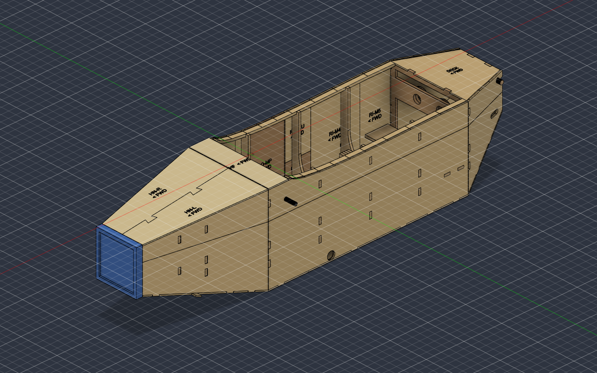
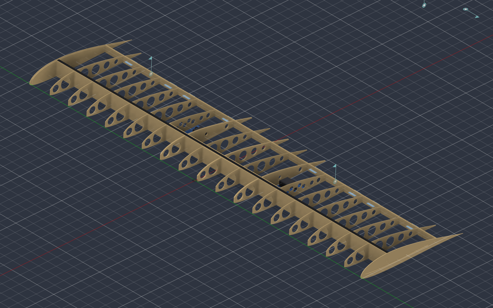
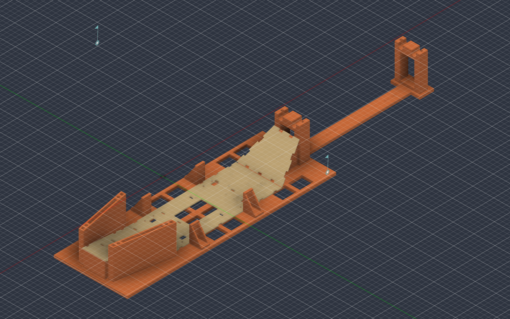
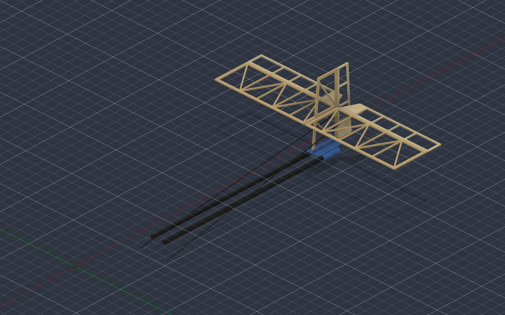

# Water-drop RC aircraft

A hand-launched electric model aircraft that carries **1 litre of water** and drops it on one command from the
pilot. Built for the **Boeing National Aeromodelling Competition 2026-27 (IIT Madras zone)**.

The score is the water mass divided by the empty mass, so the aircraft is built as light as it can be while still
surviving every flight. The current version, **rev B**, is a laser-cut balsa aircraft: about **721 g empty**
(estimate until the parts are weighed), score about **138**.


## Start here

| I want to... | Go to |
|---|---|
| **See how it goes together** | The **3D build game**: https://jagathsrujan.github.io/water-drop-rc-wing/build-game/ (or open [`docs/build-game/index.html`](docs/build-game/index.html) from a clone, works offline) |
| **Buy the materials** | The **BOM checklist** with tick boxes: https://jagathsrujan.github.io/water-drop-rc-wing/bom/ · printable [`build-kit/BOM.pdf`](build-kit/BOM.pdf) |
| **Cut, print and build** | The **build kit**: [`build-kit/`](build-kit/) (DXF, STL, PDF, guides) or the one-file download [`docs/downloads/build-kit.zip`](docs/downloads/build-kit.zip) |
| **Ask a question about the design** | Paste [`ASK_AN_AGENT.md`](ASK_AN_AGENT.md) into a coding agent |
| **Understand the design** | [`design/cad_fusion_revB/README.md`](design/cad_fusion_revB/README.md) and [`design/DECISIONS.md`](design/DECISIONS.md) |

## The aircraft

| Part | What it is |
|---|---|
| **Wing** | 990 mm span, 280 mm chord, SD7062 airfoil. Laser-cut balsa ribs, carbon-capped spar, egg-crate false spar, sheeted D-box. MG90S servo in each wing for the ailerons. Sits on top of the pod on rubber bands at +3 deg. |
| **Pod (fuselage)** | Laser-cut balsa box: two-layer sides, lite-ply formers that drop into floor slots, finger and dovetail joints, every part engraved with its name. Open at the top so the bottle lifts out. |
| **Water reservoir** | A 1 L bottle lying in laser-cut saddles, with a printed outlet and a trap door that a servo opens. Filled through the nose hatch. |
| **Tail** | Two 10 mm carbon tubes to a cruciform built-up balsa tail (fin, stabiliser, elevator, rudder). The tail servos sit in the pod. |
| **Electronics** | DYS D2830 1000 KV motor, 10 x 5 prop, Hobbywing Skywalker 40A ESC, 3S 1000 mAh battery, 5 x MG90S servos. |
| **Jigs** | 37 printed PLA jigs and a 5-piece printed jig base with locating pins: every pod jig drops onto pins, no measuring. |

| | |
|---|---|
|  |  |
|  |  |

## How to build it

1. **Buy** what is in [`build-kit/MATERIALS.md`](build-kit/MATERIALS.md) and the BOM: 41 laser sheets of balsa, ply
   and lite-ply, strip stock, carbon, electronics, glue and film. Weigh the balsa and keep the light sheets for the
   light parts.
2. **Laser-cut** the 41 DXF sheets in [`build-kit/laser/`](build-kit/laser/). Give the shop
   [`build-kit/LASER_BRIEF.md`](build-kit/LASER_BRIEF.md) and cut the kerf test first.
3. **3D-print** the jigs, the jig base and the PETG parts ([`build-kit/PRINT_LIST.md`](build-kit/PRINT_LIST.md)).
   Everything fits a 256 mm bed.
4. **Play the build game once.** It walks through all 23 steps with the real parts in 3D and tells you when you pick
   the wrong part, the wrong side, the wrong way round, the wrong order, forget a jig or a pin, glue a hinge gap or
   bend a pushrod off neutral.
5. **Build** with [`build-kit/BUILD_GUIDE.md`](build-kit/BUILD_GUIDE.md) on the bench (or the printable step list
   in the game). The order is: laminate the sides, jig base, floor, formers, keels and longerons, sides, nose ring
   and firewall, booms, deck and wing seat, saddles; then the wing on its cradles; ailerons; tail; covering;
   hinges; linkages; electronics, balance (CG at 80 mm behind the wing leading edge) and final checks.

## What is in each folder

| Folder / file | Contents |
|---|---|
| [`build-kit/`](build-kit/) | **Only what a builder needs:** laser DXF, STL, BOM PDF, build guide, laser brief, material quantities |
| [`docs/`](docs/) | The website (GitHub Pages): [build game](docs/build-game/), [BOM checklist](docs/bom/), the wing build video page, [`downloads/build-kit.zip`](docs/downloads/) |
| [`design/cad_fusion_revB/`](design/cad_fusion_revB/) | **The rev B model** (Autodesk Fusion): part scripts, laser DXF and nesting, jig STL, mass table, STEP, pictures |
| [`design/cad_fuselage_balsa/`](design/cad_fuselage_balsa/), [`design/cad/`](design/cad/), [`design/cad_reservoir/`](design/cad_reservoir/), [`design/cad_fuselage/`](design/cad_fuselage/) | The FreeCAD reference models: balsa pod rev B, wing rev A, reservoir, printed pod rev A (and tail) |
| [`design/cad_revB/`](design/cad_revB/) | A foam-block wing that was studied and not adopted |
| [`design/DECISIONS.md`](design/DECISIONS.md), [`design/DESIGN_BRIEF.md`](design/DESIGN_BRIEF.md) | Every design decision (D-001 ... D-069) and the requirements (R1-R26) |
| [`design/FIXED_MASSES.md`](design/FIXED_MASSES.md) | Bought parts and their masses (replace with weighed values) |
| [`design/logs/`](design/logs/), [`design/aero/`](design/aero/), [`design/calc/`](design/calc/), [`design/studies/`](design/studies/) | Engineering notebooks, airfoil and sizing studies |
| [`bom/`](bom/) | Indian shopping lists with shop links: wing materials ([`BOM_India.md`](bom/BOM_India.md)) and electronics ([`BOM_Electronics_Robu.md`](bom/BOM_Electronics_Robu.md)) |
| [`tools/build_kit/`](tools/build_kit/) | Makes the game data, the BOM, the PDF and the build kit from the part data |
| [`tools/fusion_bridge/`](tools/fusion_bridge/), [`tools/build_site.py`](tools/build_site.py) | The local Fusion bridge used to build the model; the website generator |
| [`ASK_AN_AGENT.md`](ASK_AN_AGENT.md) | A prompt for a coding agent to answer questions about the build |

## Key numbers (estimates until the parts are weighed)

| | |
|---|---|
| Empty aircraft (rev B, Fusion model) | about 721 g: pod 165 g, wing 157 g (+27 g servos), tail 78 g, motor + prop + ESC + battery 192 g |
| Loaded (1000 mL) | about 1.72 kg |
| Score (996 g water x 100 / empty mass) | about 138 |
| CG | 80 mm behind the wing leading edge, empty and full (the water sits on the CG, so the drop does not move it) |

Ideas to win back weight are in [`design/cad_fusion_revB/README.md`](design/cad_fusion_revB/README.md) (hex
lightening of the pod sides, lighter balsa for the inner layers).

## Making the files again

Everything in `build-kit/`, `docs/build-game/data.js` and `docs/bom/` is generated from the part data:

```powershell
python tools/build_kit/make_build_kit.py
```

It needs only Python 3 (and Chrome or Edge for the PDF), checks that every part named in the game and the BOM exists
in the part data and that the quantities add up to the nesting, and prints the result. The model itself is rebuilt
in Fusion through `tools/fusion_bridge/` (see [`design/cad_fusion_revB/README.md`](design/cad_fusion_revB/README.md));
the FreeCAD reference models have their own `run_all.py` scripts.

Prices in the BOMs are as listed online in November 2026; check before you order. No affiliation with any shop.
