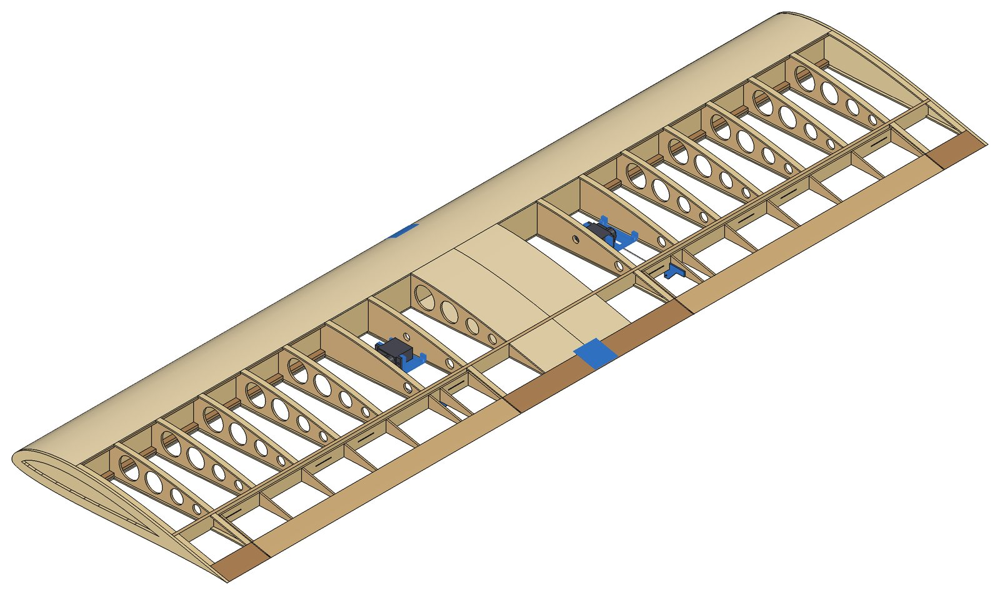

# Water-drop RC aircraft — balsa wing (rev A)

A 990 mm span, 280 mm chord, laser-cut balsa wing (SD7062 airfoil, carbon-capped spar, sheeted D-box, MG90S ailerons) for the **Boeing National Aeromodelling Competition 2026-27, IIT Madras zone** water-drop task. Predicted mass **156.6 g without servos**.

**▶ Webpage with the build video, the Indian BOM and every file:** https://jagathsrujan.github.io/water-drop-rc-wing/

## What is here

| Folder / file | Contents |
|---|---|
| [`docs/index.html`](docs/index.html) | The tutorial webpage (GitHub Pages) |
| [`docs/media/wing_build.mp4`](docs/media/wing_build.mp4) | Build and assembly video, 6:35, 1080p, narrated, captions burned in |
| [`docs/REPORT.md`](docs/REPORT.md) | Full design and build report |
| [`bom/BOM_India.md`](bom/BOM_India.md) · [`.csv`](bom/BOM_India.csv) | Indian bill of materials: shop links, what to ask for, where to buy offline |
| [`design/cad/`](design/cad/) | FreeCAD model, STEP, laser DXF (`dxf/`), PETG STL (`stl/`), cut list, mass table, check reports, pictures |
| [`design/cad/scripts/`](design/cad/scripts/) | Re-runnable FreeCAD scripts (`run_all.py` rebuilds everything) |
| [`design/DECISIONS.md`](design/DECISIONS.md) | Decision record D-001 … D-023 (options, numbers, who decided) |
| [`design/DESIGN_BRIEF.md`](design/DESIGN_BRIEF.md), [`design/02_wing_plan.md`](design/02_wing_plan.md) | Requirements and the wing plan (with the "as built" section) |
| [`design/logs/`](design/logs/) | Engineering notebooks for each stage |
| [`design/01_weather_design_inputs.md`](design/01_weather_design_inputs.md), [`design/aero/`](design/aero/) | Weather study (air density, wind) and airfoil study |
| [`design/video/`](design/video/) | Video scripts: narration, FreeCAD frame render, composer |
| [`tools/`](tools/) | Webpage and BOM generator |

## Key numbers

| Check | Result |
|---|---|
| Span / chord | 990.00 mm / 280.0 mm |
| Spar depth at x = 75.6 mm | 39.20 mm |
| Overlapping parts | 0 (276 neighbour pairs) |
| Servo clearance | ≥ 1.00 mm, arm at ±35° |
| Aileron | 325 mm, no contact at ±20° |
| Mass | 156.6 g without servos, 184.0 g with 2 × MG90S |

## Rebuild

- **CAD:** in FreeCAD 1.1, `WING_SCRIPTS = "<repo>/design/cad/scripts"` then `exec(open(WING_SCRIPTS + "/run_all.py").read())`.
- **Video:** `python3 design/video/narration.py` (macOS `say`), run `design/video/render_freecad.py` inside FreeCAD, then `python3 design/video/make_video.py`.
- **Webpage + BOM:** `python3 tools/build_site.py`.

Prices in the BOM are as listed online in November 2026; check before you order. No affiliation with any shop.
