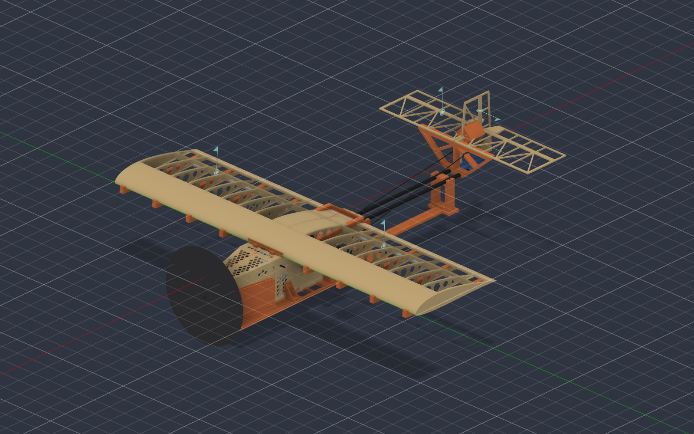
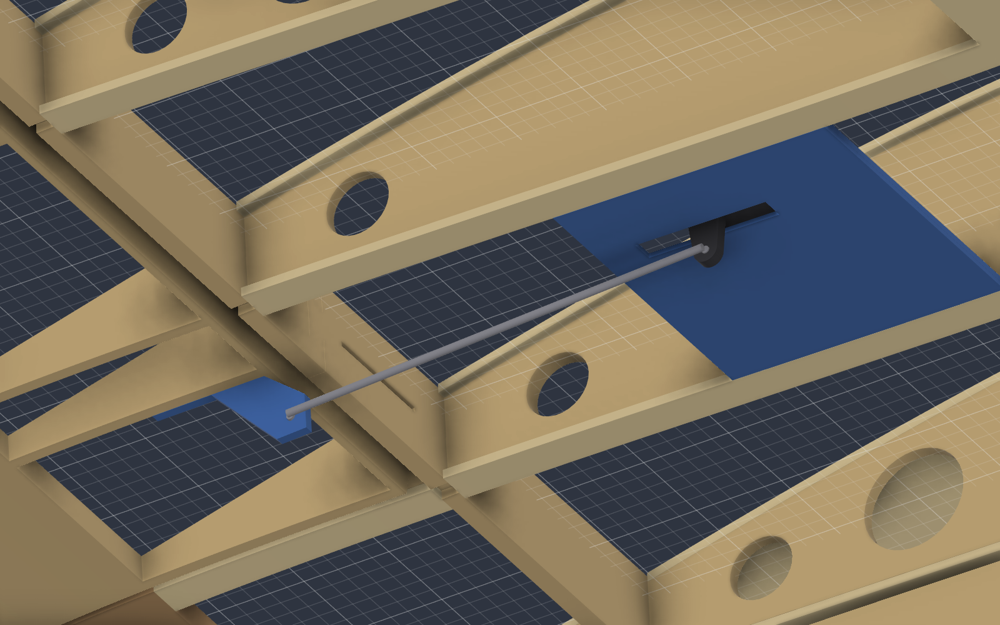
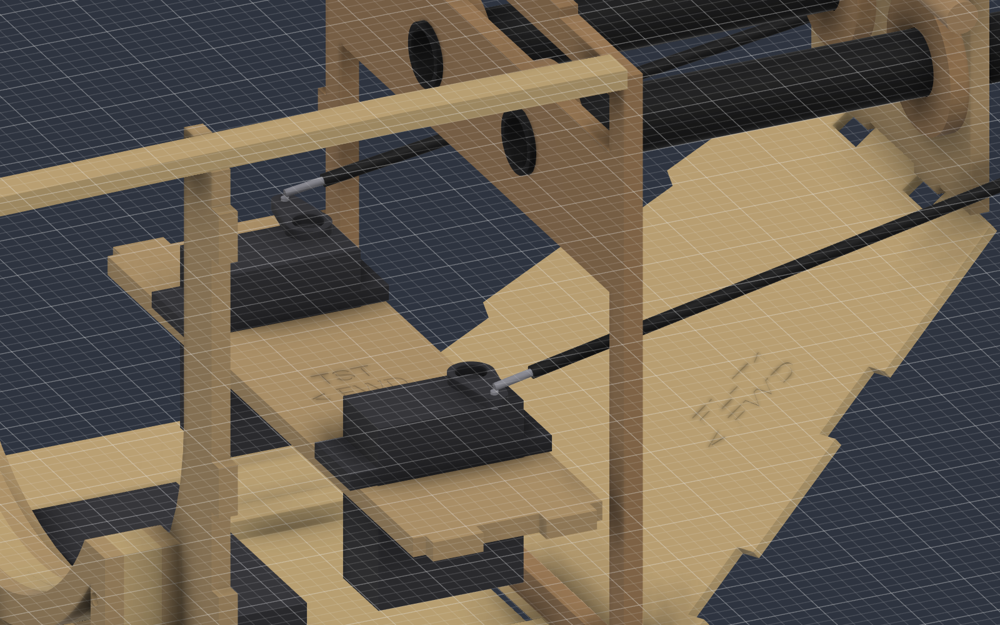

# Rev B in Fusion — the whole aircraft, remodelled for laser cutting

The balsa rev B aircraft (pod rev B, wing rev A, twin boom, cruciform tail) remodelled from scratch in Autodesk Fusion,
built live in the Fusion window through a local bridge (`tools/fusion_bridge/`). The FreeCAD models stay the reference:
every number comes from their parameter files (`bal_params.py`, `fus_params.py`, `res_params.py`, `wing_params.py`),
nothing is retyped. Status: **model complete, not yet built or weighed; the hex lightening of the pod sides is left out
in this pass.**



## Result

| | Fusion rev B | FreeCAD reference |
|---|---|---|
| Parts | aircraft + 37 jigs; 153 laser parts on 41 sheets | — |
| Pod | 165.1 g (no hex lightening, more tabs, tail-servo tray, laser saddles) | 133.1 g |
| Wing (without servos) | 156.7 g | 156.6 g |
| Tail | 78.4 g | 78.1 g |
| Empty aircraft / score | ≈ 721 g / ≈ 138 | 689 g / 144.5 |
| Interference (Fusion analysis, all bodies) | largest 0.01 mm³ (surface contacts only) | — |

The pod is 32 g heavier. The first things to try for that: the hex lightening (≈ 7 g), weighing the sheets and using
light stock for the inner layers (rev B estimate 6–8 g), and lighter saddles.

## Files

| Path | What |
|---|---|
| `export/WaterDrop_revB_fusion.f3d` | Fusion archive (open in Fusion: File → Open → Open from my computer) |
| `export/WaterDrop_revB_fusion.step` | STEP, one component per part, named as on the laser parts |
| `dxf/*.dxf` | Laser sheets: layer **CUT**, **ENGRAVE** (part names, single-stroke), **SHEET** (outline, do not cut) |
| `dxf/nesting.json`, `cut_list.md` | What is on each sheet; strip stock cut to length |
| `mass_table.md` | Mass from the Fusion bodies with the same densities, film and glue rules as the FreeCAD tables |
| `check/` | `bodies.json` (every body: material, volume, mass, box), `interference.json` (Fusion interference analysis) |
| `img/` | Pictures |
| `scripts/` | The model: `geo.py` (2D geometry), `pod.py`, `wing.py`, `tail.py` (part data), `fxlib.py` (Fusion helpers), `build_*.py` (bridge jobs), `laser*.py`, `check_model.py`, `mass_summary.py` |

## How it is built

Every part is its own Fusion component, drawn **flat in its own frame** (sketch on the component's XY plane, extruded
by the stock thickness) and placed by the component transform. So each laser part is a true flat pattern, its
bottom-face loops are the cut file, and its name is engraved 0.2 mm into the top face. Strip stock (keels,
longerons, capstrip, ledges, LE, spar caps, TE wedges, cap strips, D-box and centre sheeting) is modelled in place
and listed in the cut list. Electronics and the reservoir are simple placeholders.

Rebuild (Fusion open, ClaudeBridge running):

```powershell
python tools/fusion_bridge/fx.py design/cad_fusion_revB/scripts/build_all.py
```

Then `check_model.py` (with `DO_INTERFERENCE = True`), `laser_loops.py`, `export_views.py` in Fusion, and
`python laser.py`, `python mass_summary.py` in `scripts/`.

## Manufacturing rules

- **Sheet sizes:** balsa 100 × 300 mm with the grain along 300; every balsa part is ≤ 100 mm across the grain and is
  turned to its grain on the sheet. Ply / lite-ply 300 × 300.
- **Labels:** every laser part carries its name and a direction hint (`< FWD`, `UP ^`, `< LE`). The floor and the
  side panels also carry the name of the former that goes into each group of slots.
- **Slots** are drawn at the nominal stock thickness: set the laser's kerf offset so the tabs are a push fit. In the
  tapered nose and tail cone, the slots are opened by T·tan(angle), because the tabs cross those panels at an angle.

## Joints (stay in flight)

| Where | Joint |
|---|---|
| Formers → floor | 3 tabs per former (2 on B2 halves and the end former) through floor slots |
| Formers → sides | 2–3 tabs per side through both side layers (one in the upper strip, 1–2 in the lower) |
| Bulkhead, end former → aft deck | 2 tabs each up through the deck |
| Sides → floor | finger joint: tabs on the bottom edge of both side layers drop into notches in the floor edge |
| Floor pieces | dovetail keys (3 per joint; 2 at X 115 beside the belly opening) |
| Side laminate | outer 1.5 mm in a lower and an upper strip (joint at Z −40), inner 1.0 mm in pieces ≤ 100 mm wide with vertical grain: every joint is bridged by the other layer |
| Battery tray → nose formers | tabs into notches in the former legs |
| Tail-servo tray → sides | 2 tabs per side through the side laminate (new: replaces the rev B pads) |
| Saddles | 4 layers, each with 2 floor tabs, keel notches and 3 pin holes (2 mm toothpicks) |
| Strap bridges | legs through floor slots |
| Wing ribs → spar caps | notches (as rev A) |
| Wing ribs ↔ false spar | egg-crate: rib slotted from above, false spar from below |
| Shear webs → ribs | end tabs into rib slots: the inboard tab is high, the outboard tab low, so two webs never clash in one rib |
| False spar pieces | dovetail keys at Y ±145 and ±357.5 |
| Stabiliser halves → fin | 2 tabs per half through 4 slots in the fin (right and left tabs alternate) |
| Fin → tail block | 2 root tabs into slots in the PETG plate |
| Elevator joiner | wire laid in slots cut in the elevator halves |

## Control linkages (`scripts/linkage.py`)

| Surface | Servo / arm | Pushrod | Horn |
|---|---|---|---|
| Ailerons (×2) | MG90S flat in the bay between ribs 110 and 165; single arm down through a slot in the servo hatch, hole 12.7 mm from the shaft, 4 mm below the skin | 1.2 mm steel wire under the lower skin, parallel to X (70.5 mm between the holes), Z-bend at each end | PETG horn glued to the 2 mm horn rib **AH-R / AH-L** (laser, new) and the aileron LE; hole on the hinge line (X 209), so the throw is symmetric |
| Elevator | 9 g servo (left) on the tail-servo tray, arm 8 mm outboard | 2 mm carbon rod, 1.2 mm steel Z-bend ends 6 mm long at both ends, through the left tail-cone exit slot | 1.5 mm G10 / ply horn under the left elevator |
| Rudder | 9 g servo (right), arm 8 mm outboard | same, right exit slot | horn on the right of the rudder |

Fit check (Fusion interference analysis): the wire ends touch the tail horns by 0.1–0.2 mm³; the real Z-bends clear them.



## Assembly jigs (3D printed, removable)

37 PLA jigs in `jigs/*.stl` (one file per jig, in its own flat frame: lay it on its largest flat face in the slicer;
3 walls, 20–30 % infill; all fit a 256 mm bed). They are in the Fusion model under `Jigs` (pod and tail) and
`Wing/Jigs_Wing`. Every jig has its name engraved, 4.5 mm holes for 4 mm wood screws into the building board, and
lightening windows. `jigs/fit_check.json` is the Fusion interference check of every jig against the aircraft
(contacts only, apart from the J5 gauges, which stand where the wing goes: they are used before the wing).

| Jig | Qty | Where | Use |
|---|---|---|---|
| J1a nose wedge | 1 | pod board, X −169.5 … −40 | holds the nose floor at its 15.5° slope; groove for skid SK1 |
| J1b tail wedge | 1 | pod board, X 240 … 304.5 | holds the tail-cone floor at its 38.6° slope |
| J2 side squares | 4 | X 8–28 and 140–160, both sides | L-squares: sides vertical while the floor and former joints cure |
| J3 nose taper blocks | 2 | X −165 … −40, both sides | hold the nose sides at their plan angle (front stop to nose ring) |
| J4a / J4b boom cradles | 2 | X 305–330, 600–620 | booms parallel at Y ±16, Z −40; J4a's front face squares the end former. **Sets the tail incidence** |
| J5a / J5b seat gauges | 2 | on the side tops, X 0–140, 140–280 | wing lower surface at +3° + 1 mm foam: sand the side tops / capstrip until the gauge does not rock |
| WC1–WC5 wing cradles | 10 × 2 halves | wing board, Y ±27.5, ±137.5, ±247.5, ±357.5, ±465 | top face = airfoil lower surface (−0.1 mm), LE stop at X 0; front and rear halves key together with a dovetail. Set the airfoil and zero twist |
| TJ1 corner squares | 4 | fin / stabiliser corners, X 680–730 | fin at 90° to both stab halves while the through-tabs cure |
| TJ2 stab level gauge | 1 | on both booms, X 650–665 | stab underside parallel to the booms (0° stab incidence); slots for the pushrods |

**Pod build order:** (1) laminate the side layers flat under weights (outer strips + inner pieces, engraved faces
in); (2) screw J1a, J1b to the board, lay the floor pieces (dovetails), drop the formers into their slots, add keels and
longerons; (3) add the sides onto the tabs and finger joints with J2 and J3 in place; (4) nose ring + firewall;
(5) booms through the bulkhead and end former on J4a/J4b, glue; (6) aft deck, capstrip, sand with J5;
(7) saddle stacks on the cling-wrapped bottle (toothpick pins), then glue them in; (8) film, skids.

**Wing build order:** screw the 20 cradle halves to a 1 m board along two lines (LE stops on one straight line);
lay the bottom D-box sheet, bottom spar caps and the bottom centre sheeting in the cradles; ribs onto the caps,
false-spar pieces onto the ribs (egg-crate), webs into the rib slots; top caps, LE, TE; top sheeting last.

**Tail:** fin into the tail-block slots; stab halves through the fin slots with TJ2 under the stab and the four TJ1
squares in the corners; then the elevators (joiner wire in its slots) and the rudder.

## Changes from the FreeCAD models (proposed; not yet in `DECISIONS.md`)

1. **Pod sides:** split into strips and pieces to fit 100 mm balsa (see joints). No hex lightening in this pass.
2. **Pod:** a 3 mm lite-ply tail-servo tray between the sides replaces the rev B pads; the front-stop ring, the U
   formers and the bulkhead follow rev B. The saddles are laser-cut layers with lightening windows; the two inner
   layers of each stack are 3 mm balsa. The S2 strap bridges move 2 mm forward to clear former B4.
3. **Wing:** ribs are one piece from the LE stock to the TE stock. The false spar has its grain along the span, in
   3 pieces per side with an egg-crate joint at every rib; rev A (D-015) had vertical-grain pieces between the
   ribs. The webs get locking end tabs.
4. **Tail:** the stabiliser is two halves tabbed through the fin (rev A: one 490 mm piece through a split fin, which
   does not fit a 300 mm sheet).

## Not done yet

- Hex lightening of the side laminate (rev B saved about 7 g with it).
- Hatch magnets (4 pairs): their seats are not modelled.
- Hinge slots in the aileron and elevator LE strips are cut by hand (the false spar slots are laser-cut).
- Removable assembly jigs (rev B J1–J5) for this version.
- The wing servo bay, horns and guide clips are simplified. Electronics and the reservoir are envelopes only.
