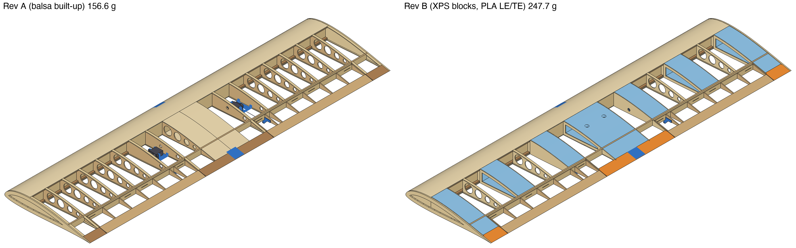
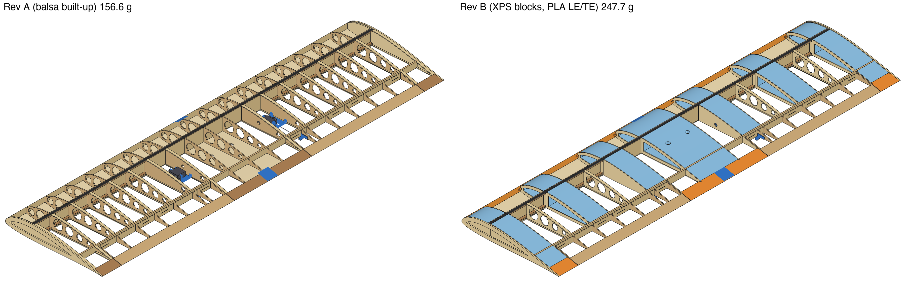
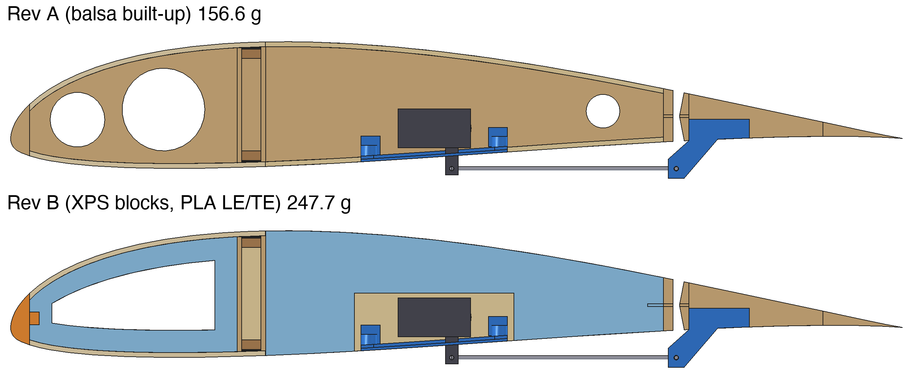
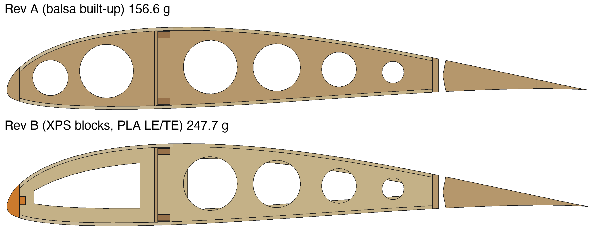
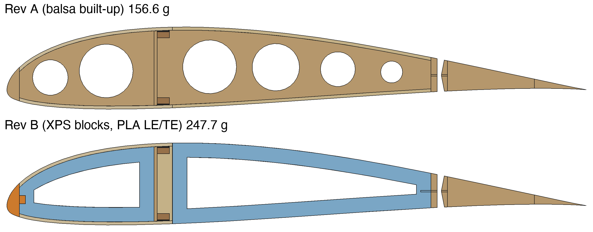
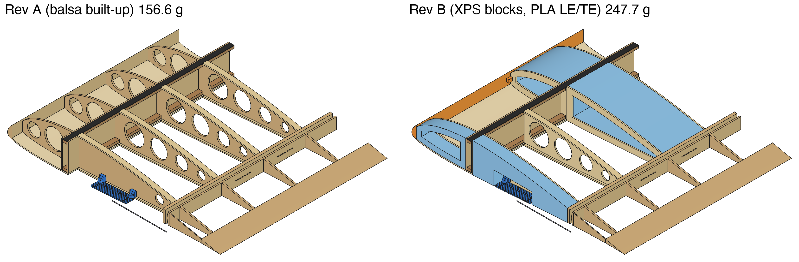
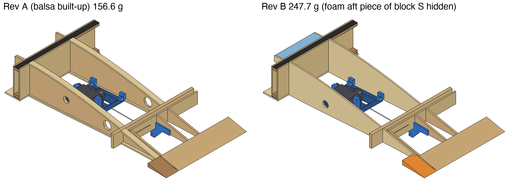

# Wing rev A (balsa built-up) against rev B (foam blocks) — comparison

Date: 2026-11-22. Decision in force: D-024 (keep rev A, model option B as rev B, compare, then choose).
Models: rev A `design/cad/Wing_revA.FCStd` (not changed: 80 file hashes are the same before and after this work); rev B `design/cad_revB/Wing_revB.FCStd` (plan `design/cad_revB/REVB_PLAN.md`, notebook `design/logs/wing_revB_log.md`, decisions D-025 … D-032).
Masses: volume × density of every modelled part (`design/cad/mass_table.md`, `design/cad_revB/mass_table.md`).

## 0. Answer

**Rev B as modelled is 247.7 g without servos, +91.1 g (+58 %) against rev A (156.6 g).**
- The score falls from 166.9 to 144.8, which is **−13.3 %**.
- The loaded stall speed is **9.11 m/s**, which **fails R6** (≤ 9.0 m/s).
- The PLA LE and TE also **fail the 60 °C sun check** (PLA HDT 57 °C).

Rev B gains local crush and impact resistance over the 43 % of the span that has foam blocks. Its blocks locate on the printed LE, and it has 38 fewer balsa pieces. It does not save build time, and it is not lighter. The best rev B variant (ASA Aero LE + balsa TE) is still +49.9 g (−7.7 %), and its stall speed is exactly 9.00 m/s with no margin.
**Recommendation: rev A.** Section 6 lists the rev B features that can move to rev A at almost no mass.

## 1. Pictures (left / top: rev A; right / bottom: rev B)

| View | File |
|---|---|
| Iso |  |
| Iso, top D-box skin removed |  |
| Section y = 140 (servo bay) |  |
| Section y = 200 (rev B hollow bay, rev A rib bay) |  |
| Section y = 300 (rev B block M) |  |
| Bay view y 150–370, top skin removed |  |
| Servo bay |  |

## 2. What rev B is (as built in CAD)
- **Blocks:** 7 XPS 30 blocks, hollow, with 7 mm walls (44–49 % removed). The positions are: centre y ±54.5, servo bays y 111.5–164, mid y 275.5–329.5, and tips y 440–490.5. Each block has a front piece (under the D-box) and an aft piece; the centre and tip blocks also have a TE piece.
- **Plates:** 14 face plates, 1.5 mm light balsa. They are the hot-wire templates: inner outline under the D-box and outer outline aft. Their holes are the cavity templates.
- **Half ribs:** 1.5 mm, x 78.6–205, at y ±220 and ±385, with cap strips.
- **Printed PLA LE:** 5 segments, each ≤ 275.5 mm. There are 14 locator keys with plate slots and 4 joiners inside the blocks.
- **Printed PLA TE:** in the fixed bays only, x 250–280, with plate slots.
- **Same as rev A:** D-box, spar, webs, false spar (span grain), ailerons, hinges, servo installation, rub plates and tip ring caps. The bottom centre sheeting is kept and the top centre sheeting is removed. The servo sits in a foam pocket.

## 3. Comparison table

| Item | Rev A | Rev B (as modelled) | Change |
|---|---|---|---|
| **Wing mass without servos** | 156.6 g | **247.7 g** | **+91.1 g (+58 %)** |
| Wing mass with servos (2 × MG90S + arms, 27.4 g) | 184.0 g | 275.1 g | +91.1 g |
| Empty mass (440 g + wing without servos) | 597 g | 688 g | +91 g |
| **Score** = 996 × 100 / empty | 166.9 | **144.8** | **−13.3 %** |
| **Loaded stall speed**, ρ 1.05, with tail download (`wing_lift_performance.py` run with the new mass: `design/cad_revB/lift_revB.txt`) | 8.86 m/s | **9.11 m/s** | R6 margin: rev A +0.14 m/s, **rev B −0.11 m/s (fails)** |
| Loaded stall, Chennai ρ 1.15 | 8.46 m/s | 8.70 m/s | — |
| Wing kinetic energy at 9 m/s (with servos) | 7.5 J | 11.2 J | ×1.5 |
| Crush (thumb or hand squeeze) | Rib edge 50 N/20 mm: margin 0.4, a local dent *(interp.)* | Blocks: XPS ≈ 200–250 kPa *(interp.)* under a 300 mm² thumb load of 167 kPa → margin ≈ 1.3; over a 7 mm wall above a cavity, a dent. Bays: film only, the same as rev A | Better over 43 % of the span, the same elsewhere |
| Impact: tip cartwheel | 3 mm tip rib + ring cap | 50.5 mm foam block + solid plate + ring cap | **Better** |
| Impact: LE hit | Balsa LE crushes (≈ 30 J/g along the grain) | PLA LE: tougher per volume (Charpy X-Y 26.6 kJ/m²), but it cracks along a layer line; foam behind it only in the blocks | About the same; 1.5× more wing energy |
| Hard landing: spar load from wing inertia | 25 % of the design moment *(study §4.1)* | ≈ 37 % | Worse |
| D-box torsion | GJ 12.6 N·m² | Same skin and spar; the blocks act as diaphragms | Same or slightly better |
| D-box skin buckling, n = 6 | Margin 1.5 (root, 53 mm bays) | Root is inside the centre block (no buckling); 54 mm bays as rev A; 108 mm bays margin 1.4 *(interp.: orthotropic plate 75 × 108.5 mm, pinned edges, applied 0.45 MPa at y = 165)* | Slightly lower, still > 1.0 |
| Film and hinge line in the long bays | 55 mm rib pitch | Half ribs give 54 mm aft of the spar (no half ribs: 3.2 mm film pillow, hinge spar bow 1.1–5.6 mm) | Same, because of the half ribs |
| Heat, Chennai sun (surface 45–60 °C) | Balsa does not soften; only the film sags | **PLA LE/TE: HDT 57 °C, fails by 3 °C** (creep under film and band load). XPS: about 75 °C limit, passes. ASA Aero (HDT 85 °C) would pass | **Worse with PLA** |
| Film attachment | Ironed to balsa (cap strips 6 mm, sheeting) | The iron (110–120 °C) melts XPS. Film bonds to the 1.5 mm plate edges and to the printed/balsa parts; on foam it needs foam-safe spray adhesive *(interp.: test on a sample)* | Worse (new method, weak 1.5 mm film edges) |
| Build pieces (modelled solids, without servos) | 147 (135 balsa, 2 carbon, 8 PETG, 2 steel) | 164 modelled solids (97 balsa, 17 foam, 38 PLA, 2 carbon, 8 PETG, 2 steel). The 38 PLA solids are 5 LE, 3 TE, 4 joiners and 26 key halves; the key halves print as part of the LE, so there are **138 build pieces** | −38 balsa pieces; +17 foam, +12 printed PLA parts |
| Build time, hands-on *(interp.)* | ≈ 24–33 h: laser 2–3 h, frame 6–8 h, sheeting and 64 cap-strip pieces 6–8 h, ailerons/servo 4–6 h, sanding and covering 6–8 h | ≈ 22–30 h: laser plates 1 h, hot-wire 17 pieces + 14 cavities 5–7 h (with test cuts), 10–14 h of unattended print time (1–2 h attended), assembly on the LE keys 4–6 h, sheeting 3–4 h, ailerons/servo 4–6 h, covering on foam 7–9 h | About the same. Alignment is easier, but there are more new methods |
| Airfoil accuracy | Laser ribs ±0.1 mm; film supported at 55 mm | Blocks: hot wire ±0.3–0.5 mm *(interp.)*, film fully supported (no scallop) over 43 % of the span; bays as rev A | Small gain in the blocks |
| Repair at the venue | Balsa, CA, film patch | Foam: foam-safe CA or epoxy, filler. A cracked PLA LE segment needs a spare print, and it is glued in | Worse |
| **Material cost** (`bom/BOM_HavocHobby.md`) | ≈ ₹9,130 + Araldite (structure) | Balsa: 3 fewer 2 mm sheets (−₹894), about 1 fewer 1.5 mm sheet (−₹248). Added (not on the Havoc pages, *(interp.)*): XPS 30 board ₹500–900, PLA ≈ 100 g ≈ ₹120, foam-safe spray adhesive ₹600–1,000 | **≈ +₹100 to +₹900** *(interp.)* |

## 4. Mass: where the 91 g comes from

| Group | Rev A g | Rev B g | Change g |
|---|---|---|---|
| Ribs, tip ribs, cap strips, aft pieces | 26.9 | Half ribs + caps 2.2 | −24.7 |
| Face plates (14) | — | 9.9 | +9.9 |
| XPS blocks (hollow) | — | 44.1 | +44.1 |
| LE | 8.5 (balsa) | 43.7 (PLA LE 40.5 + keys/joiners 3.2) | +35.2 |
| TE (fixed bays) | 2.7 (hard balsa) | 26.1 (PLA) | +23.4 |
| Centre sheeting | 5.2 | 2.5 (bottom only) | −2.7 |
| Glue | 8.0 | 14.0 (foam bonds + film spray adhesive) *(interp.)* | +6.0 |
| False spar, D-box, spar, webs, tip ring caps, ailerons, servo parts, film, hardware | 105.3 | 105.2 | −0.1 (rounded values) |
| **Total** | **156.6** | **247.7** | **+91.1** |

The printed LE and TE are 64 % of the increase (+58.6 g). The foam is 48 % (+44.1 g). The removed ribs and cap strips (−24.7 g) pay back only part of it.

### Variants (same geometry, density substitution; not separate models)

| Wing | Mass g | Δ g | Score | Change | Stall m/s | R6 |
|---|---|---|---|---|---|---|
| Rev A | 156.6 | 0 | 166.9 | — | 8.86 | pass |
| **Rev B, PLA LE/TE (as modelled)** | 247.7 | +91.1 | 144.8 | −13.3 % | 9.11 | **fail** |
| Rev B, ASA Aero LE/TE (0.70 g/cm³ *(interp.)*) | 217.3 | +60.7 | 151.5 | −9.2 % | 9.02 (lift script) | fail |
| Rev B, LW-PLA LE/TE (fails heat) | 208.9 | +52.3 | 153.5 | −8.1 % | 9.00 | fail (by 0.004) |
| Rev B-lite: ASA Aero LE + hard balsa TE | 206.5 | +49.9 | 154.1 | −7.7 % | 8.99 (lift script) | pass, no margin |

My estimate before the CAD model was about 20 g too low: +68 g for PLA (+43 g for ASA Aero). The model shows +91.1 g (+60.7 g). The causes are a heavier printed TE (26.1 g at x 250–280, against my 18 g), the glue for the foam bonds (+6 g), the keys and joiners (3.2 g), and the bottom centre sheeting that stays (+2.5 g).

## 5. Gains and losses of rev B

**Gains**
1. Crush and impact resistance in the foam blocks (43 % of the span): the tips, the band seat and the servo bay. The tips gain the most.
2. The blocks locate on the printed LE keys, so the LE is the alignment jig for the plates and blocks. Each block comes out square and true to the plate templates.
3. 38 fewer balsa pieces: 64 cap-strip pieces become 16, and 17 ribs become 14 plates + 4 half ribs.
4. The film is fully supported over the blocks, so there is no scallop there.
5. The servo sits in a foam pocket with 1.5 mm clearance to the foam (the Ø8 wire hole in plate 110 is lowered to z 5.0 so that it opens into the pocket). The servo, aileron and hinge clearances are the same as rev A (±20°: 0.74 mm; servo ≥ 1.0 mm; arm ±35°: 1.00 mm).

**Losses**
1. **Mass +91.1 g → score −13.3 %** (the best variant −7.7 %).
2. **R6 fails:** 9.11 m/s against 9.0 m/s. Only B-lite passes, at exactly 9.00 m/s.
3. **Heat:** the PLA LE/TE fail by 3 °C. ASA Aero (a new filament, on the H2D) is needed.
4. New and less certain methods: film on foam (spray adhesive, no iron), hot-wire cavities through kerfs, and foam-safe glues.
5. Repair at the venue is harder: printed LE segments, and foam that CA attacks.
6. The wing has 1.5× the kinetic energy in a crash and 1.5× the inertia load on the spar in a hard landing.
7. The hinges at y 130 and 302.5 (2 on each side) reach 5 mm into the foam of blocks S and M. The model has slots in the foam there. Glue these 4 hinges with epoxy or foam-safe CA, not thin CA (it attacks XPS).
8. No gain in build time. The hot-wire cuts, the prints and the film on foam take the time that the ribs and cap strips took before.

## 6. Recommendation
**Choose rev A.** Rev B costs 13.3 % of the score and fails R6 and the heat check. The lightest rev B that passes R6 (B-lite) still costs 7.7 % and has no stall margin.
These rev B features can move to rev A for a small mass cost (this is option C in `foam_block_wing.md`; it needs a new decision):
- **Foam tip blocks** (XPS, hollow) in place of the tip rib: about +9 g for both tips (each tip: block T 5.3 g + outer plate 1.0 g, against a tip rib of 1.8 g).
- **The LE-key idea as a removable jig:** a printed LE cradle with rib slots at the 55 mm stations. It has 0 g in flight.
- **Printed hot-wire/laser templates** for accurate sanding blocks. These are tools only.

What would make rev B win: R6 relaxed (a launch test shows that the team can throw faster than 9.1 m/s at 1.68 kg). The team would also have to accept 13 % of the score for robustness and an easier alignment. Or a weighed sample shows a much lighter printed LE/TE, for example ASA Aero at 0.5 g/cm³.
Cheapest test: print one 165 mm LE segment in PLA and in ASA Aero, cut one 54 mm XPS block, then weigh and press them. Build the same span of rev A, then weigh it and press it.

## 7. Not checked
- The film-on-foam bond and the film tension of 150 N/m *(interp.)* are not tested.
- XPS density and strength (30 kg/m³, 200–250 kPa) are not weighed or tested.
- The build hours are estimates.
- DXF laser files for the rev B plates and half ribs are not made (rev B is a comparison model).
- Rev A follow-up (not changed here): `wing_params.py`/D-015 calls the false spar "vertical grain". A vertical-grain 3 mm false spar bows about 20 mm under film tension, even at 53 mm. A 984 mm one-piece spar cut from 1000 mm stock has span-wise grain. Correct the note.
